  

  

  
  
  
  
  

---

## 👨‍💻 About me

I'm a full-stack engineer at **CSK Information and Technology**, Noida. I build web apps, mobile apps and the backends behind them, and I care most about one thing: shipping software that real people open every day.

- 📱 I built and maintain **WolfHR**, our company's HR app, live on Google Play and used daily by **50+ employees**
- 📊 I built a **sales CRM** used by **30+ salespeople** to track **200+ deals**
- 🧭 I like the tricky real-world parts: GPS geofencing, night shifts that cross midnight, approval flows, scheduled jobs
- 🎓 MCA from Chandigarh University (2022 to 2024)
- 💬 Ask me about React, React Native, Node.js, or how to stop proxy attendance

**What I'm good at:** role-based access · approval workflows · GPS and geofencing · scheduled jobs · turning feedback into shipped features

---

## 🚀 Things I've shipped

<table>
<tr>
<td width="50%" valign="top">

### 🐺 WolfHR
**HR app + admin portal + backend** &nbsp;·&nbsp; <a href="YOUR-PLAY-STORE-LINK">Live on Google Play</a>

    

- Punch-in works only inside the office area, with a separate mode for field staff
- One phone per employee to block proxy attendance
- Leave approval in two steps (Manager, then HR) with push notifications
- Live map of clocked-in staff and Excel reports
- Night shifts saved as one workday; nightly jobs close forgotten punch-outs

📱 Live on Google Play · 🔒 Company project, code is private

</td>
<td width="50%" valign="top">

### 📈 Enterprise Sales CRM
**Internal sales platform** &nbsp;·&nbsp; used daily by 30+ salespeople

    

- Three roles (Admin, Sub-Admin, Salesperson), each sees only their own data
- Sales dashboard: win rate, revenue and margin across 200+ deals
- Drag-and-drop pipeline for 140+ active opportunities, with Excel import/export
- Cost sheet that works out project margin on its own, with an approval flow

🔒 Internal company project, code is private

</td>
</tr>
</table>

---

## 🧭 Experience

| Role | Company | When |
|---|---|---|
| **Software Engineer** | CSK Information and Technology, Noida | May 2025 – Present |
| Frontend Developer (UI modernization) | Freelance, remote | Mar 2025 – Apr 2025 |

As a freelancer I redesigned a 12+ page IT company website: fixed mobile layouts on every screen size, sped it up, and added GSAP and Framer Motion scroll animations.

---

## 🧰 Tech I work with

<table>
<tr><td><b>Frontend</b></td><td></td></tr>
<tr><td><b>Mobile</b></td><td>   </td></tr>
<tr><td><b>Backend</b></td><td></td></tr>
<tr><td><b>Databases</b></td><td></td></tr>
<tr><td><b>Tools</b></td><td></td></tr>
<tr><td><b>Also</b></td><td>

</td></tr>
</table>

---

## 🛠️ Side projects

| Project | What it is | Built with |
|---|---|---|
| [**Movie Discovery App**](https://github.com/sahilraj275/Movie_App) | Search and filter movies with live data from the TMDB API | React, Tailwind, Axios |
| [**OCHI Design Clone**](https://github.com/sahilraj275/OCHI-CLONE) | A rebuild of an agency site's smooth, scroll-driven animations | React, GSAP, Locomotive Scroll, Framer Motion |
| [**Quiz WebApp**](https://github.com/sahilraj275/Quiz-WebApp) | A quiz app for practising questions in the browser | HTML, CSS, JavaScript |
| [**Employee Management System**](https://github.com/sahilraj275/Employee_Management_System) | Add, edit and manage employee records | JavaScript |

---

## 📈 On GitHub

  

  <picture>
    <source media="(prefers-color-scheme: dark)" srcset="https://raw.githubusercontent.com/sahilraj275/sahilraj275/output/github-snake-dark.svg" />
    <source media="(prefers-color-scheme: light)" srcset="https://raw.githubusercontent.com/sahilraj275/sahilraj275/output/github-snake.svg" />
    
  </picture>

---

## 🤝 Let's connect

  Got a project, a role, or just a question? I reply to every email.

  
  
  

  

